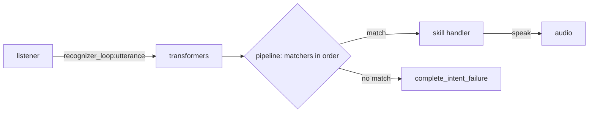

# ovos-core documentation
<!-- agent-hint
covers: the reading order of the ovos-core docs and the packages it works with
source: docs/*.md, pyproject.toml
generated: no
verify: python3 docs/check_page.py docs/index.md recognizer_loop:utterance && { for f in $(grep -o '([a-z-]*\.md)' docs/index.md | tr -d '()' | sort -u); do test -f docs/$f || exit 1; done; }
see: install-and-run.md
-->

`ovos-core` loads the skills of an OpenVoiceOS assistant and sends each utterance to the skill that handles it.



## Quickstart

```bash
uv pip install --prerelease=allow ovos-core ovos-messagebus
ovos-messagebus &
ovos-core
```

```text
INFO - IntentService is ready.
INFO - Skills Manager is ready.
```

## Pages

| Page | What you get there |
| :--- | :--- |
| [install-and-run.md](install-and-run.md) | Install options, extras, the three commands and their flags |
| [architecture.md](architecture.md) | The components in the process and the startup order |
| [skill-manager.md](skill-manager.md) | How skills are found, loaded, gated by connectivity and unloaded |
| [intent-service.md](intent-service.md) | How an utterance becomes a match and a dispatch |
| [pipeline.md](pipeline.md) | How to set the order of the matchers, and the plugin IDs |
| [transformers.md](transformers.md) | The utterance, metadata and intent transformer stages |
| [personas.md](personas.md) | How to answer with an LLM persona |
| [converse-fallback.md](converse-fallback.md) | How converse and fallback pick a skill |
| [skill-installer.md](skill-installer.md) | How to install and uninstall skills over the bus |
| [bus-events.md](bus-events.md) | Each bus message that the service sends or handles |
| [performance-metrics.md](performance-metrics.md) | How to turn on the latency histograms |
| [testing.md](testing.md) | How to run the unit and end-to-end tests |
| [prerelease-quirks.md](prerelease-quirks.md) | What changed since the last stable release |

## Related packages

| Package | Role |
| :--- | :--- |
| [ovos-messagebus](https://github.com/OpenVoiceOS/ovos-messagebus) | The WebSocket broker that all services connect to |
| [ovos-bus-client](https://github.com/OpenVoiceOS/ovos-bus-client) | `MessageBusClient`, `Message` and `Session` |
| [ovos-workshop](https://github.com/OpenVoiceOS/ovos-workshop) | `OVOSSkill`, `FallbackSkill` and the skill loader. Start here to write a skill. |
| [ovos-plugin-manager](https://github.com/OpenVoiceOS/ovos-plugin-manager) | Plugin discovery. Start here to write a pipeline plugin. |
| [ovos-config](https://github.com/OpenVoiceOS/ovos-config) | The `Configuration` that reads `mycroft.conf` |
| [ovos-utils](https://github.com/OpenVoiceOS/ovos-utils) | Logging, process status, file watching and the metrics endpoint |
| [ovos-dinkum-listener](https://github.com/OpenVoiceOS/ovos-dinkum-listener) | Sends `recognizer_loop:utterance` |
| [ovos-audio](https://github.com/OpenVoiceOS/ovos-audio) | Speaks the answers and plays `mycroft.audio.play_sound` |
